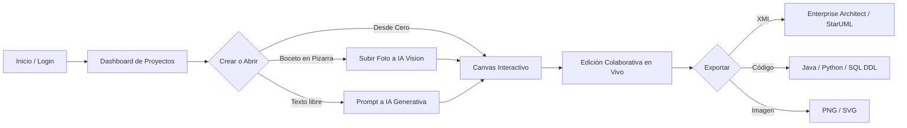

# 📘 Resumen General y Arquitectura del Software
## Herramienta Colaborativa de Modelado UML con IA (UMLCraft)

---

## 1. 🎯 Introducción y Propósito del Sistema

El software es una **plataforma web integral para el modelado, diseño y generación de software a partir de Diagramas de Clases UML**, orientada tanto a estudiantes de Ingeniería de Software como a equipos de desarrollo profesionales.

Permite construir diagramas de clases estándar con una interfaz visual intuitiva inspirada en herramientas como StarUML y Enterprise Architect, agregando tres pilares modernos:
1. **Colaboración en tiempo real multi-usuario** mediante WebSockets.
2. **Asistencia mediante Inteligencia Artificial Generativa y Visión Artificial** (Google Gemini) para diseñar diagramas desde texto o a partir de fotografías de pizarras y bocetos en papel.
3. **Interoperabilidad bidireccional estándar OMG UML 2.1 / XMI Enterprise Architect** y **generación automática de código fuente y bases de datos SQL**.

---

## 2. 🏛️ Arquitectura Tecnológica

El sistema se compone de una arquitectura distribuida desacoplada (Frontend SPA + Backend ASGI + Base de Datos Relacional):

```
┌────────────────────────────────────────────────────────┐
│               Navegador Web (Cliente)                  │
│       React 18 + Vite + React Flow + Tailwind/CSS      │
└───────────────┬────────────────────────┬───────────────┘
                │ HTTP REST (JSON)       │ WebSockets (WSS)
                ▼                        ▼
┌────────────────────────────────────────────────────────┐
│              Servidor Web Nginx (Reverse Proxy)        │
└───────────────┬────────────────────────┬───────────────┘
                │ /api/                  │ /ws/
                ▼                        ▼
┌────────────────────────────────────────────────────────┐
│           Servidor ASGI Daphne (Python / Django)       │
│                                                        │
│  ├── Django REST Framework (API CRUD, Auth, Projects)  │
│  ├── Django Channels (WebSockets, Cursores, Eventos)   │
│  ├── Motor de IA Core (Google Gemini Vision & Text)    │
│  ├── Generador / Parser XMI (OMG UML 2.1 & EA 6.5)     │
│  └── Motor de Código (Python, Java, TypeScript, SQL)   │
└───────────────────────────┬────────────────────────────┘
                            │ PostgreSQL ORM
                            ▼
┌────────────────────────────────────────────────────────┐
│             Base de Datos PostgreSQL (Local/EC2)       │
│  - Usuarios, Proyectos, Colaboradores, Snapshots       │
└────────────────────────────────────────────────────────┘
```

### Tecnologías Clave:
* **Frontend:**
  * **React 18 + Vite:** Interfaz reactiva de alto rendimiento y bajo tiempo de carga.
  * **@xyflow/react (React Flow):** Canvas interactivo infinito con zoom, paneo, mini-mapa y soporte de grafos dirigidos.
  * **Axios:** Cliente HTTP para la comunicación con la API REST mediante tokens JWT.
* **Backend:**
  * **Django 5 & Django REST Framework:** API REST robusta, ORM, serializadores y seguridad.
  * **Django Channels & Daphne:** Servidor ASGI asíncrono para manejar WebSockets en tiempo real.
  * **PostgreSQL:** Base de datos relacional para usuarios, proyectos y snapshots versionados.
* **Inteligencia Artificial:**
  * **Google Gemini API (Flash/Vision):** Procesamiento de lenguaje natural y visión multimodal.
* **Infraestructura Cloud:**
  * **AWS EC2 (Ubuntu Linux) + Nginx + Systemd (Daphne Daemon).**

---

## 3. 🧩 Módulos y Funcionalidades del Software

### 3.1. Gestión de Cuentas y Proyectos (`accounts` y `projects`)
* **Autenticación JWT:** Registro e inicio de sesión seguro con tokens de acceso y refresco rotativos.
* **Dashboard de Proyectos:** Vista en cuadrícula de proyectos creados, fecha de última modificación, buscador y creación rápida.
* **Gestión de Colaboradores:** Permite invitar a otros usuarios mediante su correo o nombre de usuario con roles configurables (**Propietario**, **Editor**, **Visualizador**).

---

### 3.2. Canvas de Modelado UML Interactivo (`DiagramPage.jsx`, `ClassNode.jsx`, `UMLEdge.jsx`)
* **Nodos de Clase Personalizados (`ClassNode`):**
  * **Cabecera:** Nombre de la clase, visibilidad y estereotipo opcional (ej. `<<interface>>`, `<<abstract>>`, `<<entity>>`).
  * **Atributos:** Visibilidad (`+` público, `-` privado, `#` protegido, `~` paquete), nombre y tipo de dato (`int`, `String`, `float`, `bool`, `date`, tipos personalizados). Edición en línea directa sin necesidad de modales complejos.
  * **Métodos / Operaciones:** Visibilidad, nombre del método, parámetros tipados y tipo de retorno (ej. `+ calcularTotal(descuento: float): float`).
* **Conexiones y Relaciones UML Estándar (`UMLEdge`):**
  * **Asociación Simple:** Línea sólida entre clases.
  * **Asociación Dirigida:** Flecha simple indicando navegabilidad.
  * **Agregación:** Rombo blanco/vacío en el extremo de la clase contenedora (todo/parte débil).
  * **Composición:** Rombo negro/relleno en el extremo de la clase contenedora (ciclo de vida dependiente).
  * **Generalización / Herencia:** Flecha triangular hueca hacia la clase padre.
  * **Realización / Implementación:** Línea discontinua con flecha triangular hueca (para interfaces).
  * **Dependencia:** Línea discontinua con flecha simple.
  * **Multiplicidades:** Configuración editable en ambos extremos (`1`, `0..1`, `1..*`, `*`, `0..*`, o texto libre).
  * **Handles Inteligentes:** Conexión automática desde los cuatro costados (arriba, abajo, izquierda, derecha) con cálculo del camino óptimo.

---

### 3.3. Motor de Colaboración en Tiempo Real (`realtime/consumers.py`, `useCollaboration.js`)
* **WebSockets Bidireccionales:** Cada vez que un usuario abre un proyecto, se suscribe al grupo WebSocket del proyecto (`project_<id>`).
* **Cursores en Vivo con Presencia:** Los colaboradores ven los punteros de los demás usuarios en tiempo real, identificados con colores únicos y el nombre del usuario flotante.
* **Sincronización de Diagrama sin Conflictos:**
  * Cambios de posición, adición de clases, modificación de atributos y conexiones se difunden instantáneamente a todos los clientes conectados.
  * Uso de *debouncing* y control de estado para evitar sobrecarga de red y bucles de sincronización.
  * Indicador de estado de conexión (`Conectado`, `Reconectando`, `Desconectado`).

---

### 3.4. Inteligencia Artificial Multimodal (`ai_core`, Gemini 3.8 / 1.5)
El sistema incluye tres modos de asistencia con IA:
1. **Generación desde Texto (Prompt-to-UML):**
   * El usuario describe un caso de uso (ej. *"Crea el diagrama de clases para un sistema de biblioteca con préstamos, socios, multas y libros"*).
   * La IA analiza los requerimientos y devuelve una estructura JSON precisa con clases, atributos, métodos y relaciones tipadas que se inyectan automáticamente en el lienzo.
2. **Reconocimiento de Bocetos y Pizarras (Image-to-UML Vision):**
   * El usuario sube o arrastra una fotografía de un diagrama dibujado a mano alzada en papel o en una pizarra.
   * El modelo de visión de Gemini interpreta las cajas, textos, flechas y rombos, convirtiendo la imagen física en un diagrama interactivo digital editable.
3. **Chatbot Asistente y Tutor UML (`HelpChatBot`):**
   * Responde dudas conceptuales de diseño orientado a objetos, sugiere patrones de diseño (Singleton, Factory, Observer) y analiza inconsistencias en el diagrama actual.

---

### 3.5. Interoperabilidad XMI / Enterprise Architect (`xmi_generator.py`, `xmi_parser.py`)
Permite trabajar de forma híbrida entre esta herramienta web y **Sparx Systems Enterprise Architect**:
* **Exportación XMI 2.1 (Compatible con Enterprise Architect 6.5+):**
  * Genera el estándar OMG UML 2.1 con el paquete y diagrama lógico organizado.
  * **Supresión de `{bag}`:** Declara atributos con multiplicidad escalar estricta (`lowerValue=1`, `upperValue=1`, `isUnique=true`) y propiedades nativas de EA (`collection="false"`, `duplicates="0"`).
  * **Conservación de Geometría:** Inyecta las coordenadas `Left`, `Top`, `Right`, `Bottom` de cada elemento y los conectores para que al abrir el archivo `.xmi` en EA el diagrama aparezca completamente dibujado y colocado.
* **Importación XMI Robusta:**
  * Lee archivos generados tanto por Enterprise Architect (XMI 1.1 y 2.1) como por StarUML y MagicDraw.
  * Resuelve tipos primitivos (`int`, `String`, `float`, `date`, `bool`) desde la extensión de EA o el metamodelo UML sin degradarlos a `String`.

---

### 3.6. Generación de Código y Base de Datos (`engine.py`)
Permite pasar del modelo conceptual al código de producción en un clic:
* **Generación de Código Orientado a Objetos:**
  * **Python:** Clases con `__init__`, tipado de argumentos, docstrings y relaciones.
  * **Java:** Clases completas con modificadores de acceso, tipos de datos, getters, setters y listas para relaciones de multiplicidad múltiple.
  * **TypeScript:** Interfaces y clases tipadas.
* **Generación de Esquema de Base de Datos SQL (DDL):**
  * Sentencias `CREATE TABLE` con tipos de columna mapeados (`INT`, `VARCHAR`, `BOOLEAN`, `TIMESTAMP`, `DECIMAL`).
  * Claves primarias (`PRIMARY KEY`), claves foráneas (`FOREIGN KEY ... REFERENCES`) con resolución de cardinalidades 1..1, 1..N y tablas intermedias para relaciones N..M.

---

### 3.7. Historial de Versiones y Snapshots (`HistoryModal.jsx`)
* **Guardado Automático y Manual de Estados:** Permite tomar "fotografías" (snapshots) del estado del proyecto en cualquier momento con un título o etiqueta.
* **Restauración en un Clic:** Permite volver atrás en el tiempo para recuperar diagramas anteriores en caso de errores de modelado o cambios de requerimientos.

---

## 4. 🚀 Flujo de Trabajo Típico de Usuario



---

## 5. ☁️ Infraestructura de Despliegue en AWS

El software está alojado en una instancia **Amazon EC2**:
* **Sistema Operativo:** Ubuntu Server LTS.
* **Servidor Web / Reverse Proxy:** **Nginx**:
  * Puerto 80 para tráfico web general.
  * Sirve los archivos estáticos precompilados del frontend (`/dist`).
  * Enruta `/api/` hacia el backend en el puerto local `8000`.
  * Enruta `/ws/` aplicando actualización de protocolo a **WebSockets** (`Upgrade: websocket`).
* **Servidor de Aplicaciones:** **Daphne** administrado como servicio de sistema `systemd` (`daphne.service`):
  * Supervisión continua con reinicio automático ante fallos (`Restart=always`).
* **Base de Datos:** **PostgreSQL** configurada de forma local en la instancia para alta velocidad de acceso y cero costo adicional de infraestructura.

---

## 6. 📁 Estructura del Repositorio de Código

```
parcial sw1/
├── backend/                        # Servidor Django + ASGI
│   ├── config/                     # Configuración principal (settings, asgi, wsgi, urls)
│   ├── apps/
│   │   ├── accounts/               # Autenticación JWT y usuarios
│   │   ├── projects/               # Modelos de proyectos, permisos, snapshots
│   │   │   └── generators/         # xmi_generator.py (exportador) y xmi_parser.py (importador)
│   │   ├── realtime/               # Consumidores WebSocket (Django Channels)
│   │   ├── ai_core/                # Integración con Google Gemini (Texto y Visión)
│   │   └── generator/              # Motor generador de código (engine.py: Java, Python, SQL)
│   └── manage.py                   # Administrador de comandos de Django
├── frontend/                       # Aplicación SPA React
│   ├── src/
│   │   ├── api/                    # Configuración centralizada de Axios
│   │   ├── components/             # Nodos UML, Edges, Menú StarUML, Modales IA, Cursores
│   │   ├── hooks/                  # useCollaboration (WebSocket), useDiagram
│   │   ├── pages/                  # LoginPage, RegisterPage, ProjectsPage, DiagramPage
│   │   └── store/                  # Gestión de estado global
│   └── package.json                # Dependencias (React, Vite, @xyflow/react, Lucide icons)
└── RESUMEN_GENERAL_SOFTWARE.md     # Documentación general y arquitectura
```

---

## 7. 🏆 Resumen de Valor del Proyecto

| Característica | Software Tradicional (StarUML, EA) | Este Software |
| :--- | :--- | :--- |
| **Acceso** | Instalación de escritorio pesada | 100% Web desde cualquier navegador |
| **Colaboración** | Archivos locales compartidos | Tiempo real simultáneo con cursores en vivo |
| **Creación con IA** | No disponible / Plugins de terceros | IA integrada: Texto a UML y Foto de pizarra a UML |
| **Interoperabilidad** | Propietaria | Round-trip compatible con XMI OMG UML 2.1 |
| **Generación** | Requiere módulos adicionales | Generación instantánea de Java, Python y SQL |
